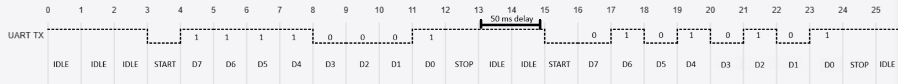
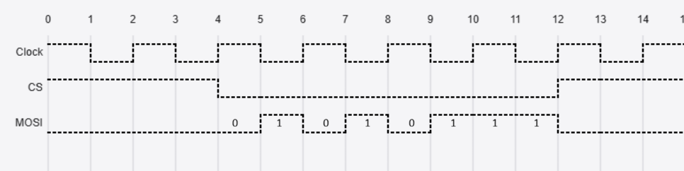

# ECE528HW3

## Section I: Review Questions

1. The MSP432 uses the eUSCI_A modules for UART communication. Describe the function of the following registers:
- UCAxBRW (Baud Rate Control Word): sets the Baud Rate (communication speed) depending on the division factor, N
- UCAxMCTLW (Modulation Control Word) - fine tunes the baud rate so two devices are communicating at the exact same speed
- UCAxCTLW0 (Control Word 0) - configures UART settings such as parity, data bit length, stop bits, clock source, and UART mode
- UCAxRXBUF (Receive Buffer) - stores the most recent UART data
- UCAxTXBUF (Transmit Buffer) - holds the data that is about to be sent serially 

2. What is the purpose of the UCAxSTATW status register in the UART module? Which bits indicate the following?

The purpose of UCAxSTATw status register is to monitor whether the UART module is busy transmitting or receiving data. It also shows whether communication errors have occurred.

- Whether the UART module is currently transmitting - Bit 0 
- Whether a framing, parity, or overrun error has occurred
    - Framing Error: Bit 6
    - Parity Error: Bit 4
    - Overrun Error: Bit 5
- Whether the RX buffer contains unread data - Bit 0 of UCRxIFG

3. Assume that the eUSCI_A3 module is using SMCLK as its clock source, which has a frequency of 12 MHz. Calculate the value that is needed to be written to the UCAxBRW register to configure the eUSCI_A3 module for 115200 baud.

N = Clock Frequency / Baud Rate
N = 12000000 / 115200
N = 104.167

4. (a) Write a function named UART2_Init that configures the eUSCI_A2 module for the following settings:
- Baud Rate: 115200
- Data Length: 8 bits
- Parity: None
- Stop Bits: 1
- Bit Order Most Significant Bit (MSB) First
- Clock Source: SMCLK (12 MHz)
- Pins: P3.2 (UCA2TXD) and P3.3 (UCA2RXD)

```
void UART2_Init()
{
    P3->SEL0 |= 0x0C;
    P3->SEL1 &= ~0x0C;
    EUSCI_A2->CTLW0 |= 0x01;
    EUSCI_A2->CTLW0 &= ~0x8000 ; // Disables parity bit
    EUSCI_A2->CTLW0 |= 0x2000; // Set the bit order to MSB
    EUSCI_A2->CTLW0 &= ~0x1000; // Selects 8-bit character length
    EUSCI_A2->CTLW0 &= ~0x800; // Selects one stop bit
    EUSCI_A2->CTLW0 |= 0xC0; // Selects SMCLK
    EUSCI_A2->BRW = 104; // 115200 Baud Rate
}
```

(b) Suppose that you have a main program that is transmitting data using the eUSCI_A2 module given the configuration in part (a). Draw the waveform for the UART TX data line if the main program is transmitting two bytes: 0xF1 followed by 0x55. Clearly label the start bits, data bits, and stop bits. Assume that there is a 50 ms delay between the two bytes.



5. What is the function of the eUSCI_B module? How does SPI communication differ
from UART communication in terms of:
- Synchronization - SPI is synchronous while UART is asynchronous
- Clocking - SPI sends a shared serial clock to the slaves while UART has no shared clock but requires matching baud rates
- Signaling - Every slave device shares the same clock generated from the master. The MOSI signal is shared by the slaves. Similarly, the MISO is a signal connected with all the slaves and sent to the master. The master has separate control pins for every slave device.
- Data Framing - SPI uses a Chip Select (Signal) and clock signal (SCLK) to coordinate data transfer while UART uses start, stop, and parity bits for data transfer.

The eUSCI_B module allows for synchronous serial communication protocols using either SPI or I2C.

6. (a) Explain the role of the following SPI signals:
- SCLK - serial clock generated by the master that is sent to the slaves
- CS (Chip Select) - allows the master to choose which slave to communicate/transmit data to
- MISO (Master In, Slave Out) - data sent from the slave to the master
- MOSI (Master Out, Slave In) - data sent from the master to the slave

(b) What happens if multiple SPI peripheral devices have their CS line asserted simultaneously on the MSP432?

All selected devices will attempt to communicate with the MSP432 which can cause several issues: data corruption, unintended communication, and conflicting signals.

7. (a) Briefly describe the function of the UCBxCTLW0 (Control Word 0) register from the eUSCI_B module.

The UCBxCTLW0 register from the eUSCI_B selects the communication mode (SPI or I2C), configure clock source/settings, set master or slave mode, and reset.

(b) Which bits need to be cleared or set in the UCBxCTLW0 register to configure the SPI mode used by the eUSCI_B module? Provide a description of each bit.

Bit 9-10 configure the SPI mode used by the eUSCI_B module.

| Bit 10 | Bit 9 | Mode                                 |
|--------|-------|--------------------------------------|
| 0      | 0     | 3-pin SPI                            |
| 0      | 1     | 4-pin SPI (Slave-Enable Active High) |
| 1      | 0     | 4-pin SPI (Slave-Enable Active Low)  |
| 1      | 1     | I2C                                  |

(c) Which field in the UCBxCTLW0 register selects the clock source used by the
eUSCI_B module? Provide the values used and the corresponding clock sources.

Bit 6-7 selects the clock source used by the eUSCI_B module.

| Bit 7 | Bit 6 | Clock Source |
|-------|-------|--------------|
| 0     | 0     | UCLK         |
| 0     | 1     | ACLK         |
| 1     | 0     | SMCLK        |
| 1     | 1     | SMCLK        |

8. (a) Write a function named EUSCI_B0_SPI_Init that configures the eUSCI_B0 module for SPI communication with the following settings:

- SPI Mode: 0
- Data Length: 8 bits
- Bit Order: Most Significant Bit (MSB) First
- Clock Source: SMCLK (12 MHz)
- SPI Clock Frequency: 1 MHz
- SPI format: 3-wire SPI
- SPI Pins:
    - P1.5: SCLK (UCB0CLK)
    - P1.6: MOSI (UCB0SIMO)
    - P1.7: MISO (UCB0SOMI)
    - P9.0: Active Low Chip Select (GPIO)

```
void EUSCI_B0_SPI_Init()
{
    EUSCI_B0->CTLW0 |= 0x8000; // SPI Mode: 0
    EUSCI_B0->CTLW0 &= ~0x4000;
    EUSCI_B0->CTLW0 &= ~0x1000; // Selects 8-bit character length
    EUSCI_B0->CTLW0 |= 0x2000; // Set the bit order to MSB
    EUSCI_B0->CTLW0 |= 0x80; // Selects SMCLK
    EUSCI_B0->BRW |= 12; // 1 MHz SPI clock frequency
    EUSCI_B0->CTLW0 &= ~0x300; // 3-wire SPI

    // P.15: SCLK
    P1->SEL0 |= 0x20;
    P1->SEL0 &= ~0x20;

    // P1.6: MOSI and P1.7: MISO
    P1->SEL0 |= 0xC0;
    P1->SEL0 &= ~0xC0; 

    // P9.0: Active Low Chip Select
    P1->SEL0 &= ~0x00;
    P1->SEL0 &= ~0x00;
    P1->DIR &= 0x00; // active low
    P1->OUT |= 0x00; // output
}
```

(b) If a main program transmits one byte with a value of 0x57, draw the waveforms for:
- Chip Select (Active Low)
- SCLK
- MOSI


